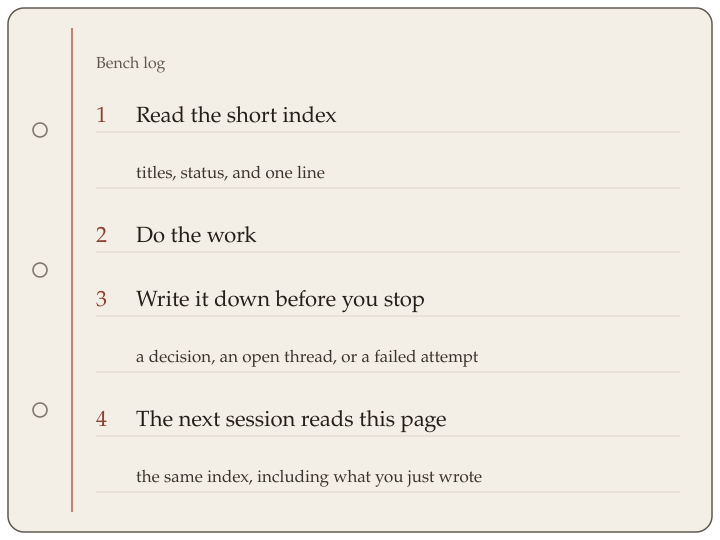

<p align="center"></p>

# Waybook

Waybook is a git-aware lab notebook for coding-agent teams. A coding agent forgets the last session. Waybook keeps a small board in the project so the next session can read what was decided, what is still open, and what was already tried and failed. The notes sit next to the code. A note can name the commit or pull request it belongs to.

## How it works

A session starts by reading a short index: the title, the status, and one line for each note. The agent does the work. It then writes what happened, through the `waybook` command, into one of three sections: `decisions`, `open-threads`, or `failed-attempts`.

A note is written once. To correct it, add a new note that points at the old one. Do not edit the old file by hand. `mark-resolved` and `prune` change only the status and archive fields.

At the end of the session, scratch notes left in `.waybook/.pending/` are filed as one open thread. When you run `prune`, Waybook moves a note to the archive if you marked it resolved, if its linked pull request is merged or closed, or if its linked commit is already on the default branch. Prune does not run by itself when a pull request merges.

In a git checkout, the index also names the current tip of the default branch. An open note that mentions an older commit is marked possibly stale. That mark is computed when the index is read. It is not saved, and Waybook does not fetch.



*Read the index, do the work, write the note, and the next session reads the same page.*

## What it is

The board is a directory of markdown files, `.waybook/`, with three sections: **decisions**, **open threads**, and **failed attempts**. At the start of a session the agent prints a short index and expands only the notes that match its query. At the end it records what happened. If a session dies, a hook can file the unfinished notes.

Waybook is modest on purpose:

- It does not remember a person's preferences.
- It does not check that a note is true.
- It does not prove that reading only the matching notes is useful.
- Each note has a hidden usefulness number. That number is a heuristic, not a measurement, and commands never print it.

## Features

- Three sections, one markdown file per note, with a versioned schema (currently v2) and a migrator.
- Writes go through the CLI, or through the MCP server, which uses the same code. Notes are append-only, stored read-only (`0444`), and covered by a hash chain. `waybook verify` detects a hand edit.
- `warm-start` prints a short index, about 40 lines. A query expands the notes whose title or one-liner matches. By default it rewrites `index.md` and, when a query expands a match, bumps that note's hidden usefulness counter. `--read-only` prints the same text and writes nothing. In a git checkout it also prints the live tip of the default branch and flags an open note that names an older commit.
- `prune` archives a note because it was resolved, because its pull request merged or closed, or because its commit is on the default branch. It never archives by age. The archive is never deleted.
- A closeout skill, a session-end `flush` hook for pending notes, and a one-shot silence `watchdog`.
- A stdio MCP server, so an agent can call the board as tools.
- A coordinator role for an audited read of another project's board.
- Writes refuse text that looks like a cloud key, a private-key header, or a common API token.
- Python 3.11 or newer, and the standard library only. No network service and no global store.

## Try it yourself

Put one line in the job preamble: run `waybook warm-start` before the first edit. Then run your jobs.

```sh
waybook warm-start
waybook list
waybook show <id>
```

`waybook list` counts the entries on the board. `waybook show <id>` is the note a later job would be citing. `.waybook/log/audit.jsonl` records adds, resolves, and prunes. It does not record warm-start, so count those in the job log.

## Install

Requires Python 3.11 or newer.

```sh
git clone https://github.com/tflaim/waybook.git
cd waybook
./install.sh
```

`./install.sh` creates a virtualenv at `~/.local/share/waybook/venv` and symlinks that environment's `waybook` command to `~/.local/bin/waybook`. If `~/.local/bin` is not on `PATH`, the installer prints a warning. Running it again updates the virtualenv. A symlink that already points into that virtualenv, including a dangling or stale one, is repaired. A directory is reused only when it has `pyvenv.cfg` and its `bin/python` reports `sys.prefix != sys.base_prefix` with the same version as the selected Python. If that interpreter does not run, is not a virtualenv, or the version differs, the virtualenv is rebuilt. A foreign file at `~/.local/bin/waybook`, or a directory at the virtualenv path that is not a virtualenv, is left in place unless `--force` is passed. `--force` on that directory prints a warning naming the path, then removes it.

The installer picks the Python for that virtualenv in this order:

1. `--python <path>`, or `WAYBOOK_PYTHON` when the flag is omitted. When both are set, `--python` wins. That interpreter has to be Python 3.11 or newer. If it is missing or older, the installer exits and reports the version it found.
2. `python3.13`, then `python3.12`, then `python3.11` on `PATH`, the first whose version is 3.11 or newer.
3. `python3` on `PATH`, when its version is 3.11 or newer.

If none of those qualifies, the installer exits and lists each interpreter it found, with its version. Install Python 3.11 or newer, or run `./install.sh --python /path/to/python3.11`. `WAYBOOK_PYTHON` accepts the same path. On macOS, `/usr/bin/python3` is often Apple's Python 3.9. A versioned name on `PATH`, such as `python3.12`, is used before that `python3`.

From a checkout you can also run `python3 -m pip install -e .`, or `python3 -m waybook` with the repo root on `PYTHONPATH`. The [GitHub CLI](https://cli.github.com/) (`gh`) and `git` are used only by `prune`, to look up pull request and commit state.

## Quick start

Run these from inside your project. The board lives in `<project>/.waybook/`.

```sh
waybook init --project-id your-org/your-repo
waybook --agent alice add decisions --title "Flat files" --one-liner "No DB" --link pr:97
waybook --agent alice add failed-attempts --title "Tried SQLite" --one-liner "Locking issues"
waybook list --section decisions
waybook show <id>                                   # id from `waybook list`
waybook mark-resolved <id> --resolution explicit
waybook verify
waybook warm-start
waybook warm-start --query sqlite
```

`waybook add` prints the new entry id. `--agent` (or `WAYBOOK_AGENT`) records who wrote the entry. `--link pr:97` stores the pull request under the board's `project_id`, so set a real `owner/name` with `init --project-id`.

## CLI usage

Global flags: `--json`, `--version` (print the package version and exit 0), `--project <path>` (default: the nearest ancestor containing `.waybook/`), `--agent <name>` (or `WAYBOOK_AGENT`), and `--role coordinator` (or `WAYBOOK_ROLE`).

| Command | What it does |
| --- | --- |
| `init [--project-id ID] [--coordinator]` | Create `.waybook/` |
| `add <section> --title T --one-liner L [--body-file F] [--link commit:SHA\|pr:N]... [--supersedes ID]` | Append one entry. Sections: `decisions`, `open-threads`, `failed-attempts` |
| `list [--section S] [--status S] [--archived]` | List entries |
| `show <id>` | Show one entry (without the hidden score) |
| `mark-resolved <id> [--resolution explicit] [--note TEXT]` | Set status, `resolved_at`, and `resolution` |
| `prune [--dry-run]` | Archive resolved entries, entries whose pull request is merged or closed, or whose commit is on the default branch |
| `index [--print]` | Regenerate `index.md` |
| `warm-start [--query TEXT] [--read-only]` | Print the short index (with the live `main:` line in a git checkout) and expand sections whose title or one-liner match. The default rewrites `index.md` and bumps usefulness for each expanded match. `--read-only` writes nothing |
| `verify` | Check the schema and the hash chain |
| `migrate [--to 2]` | Migrate an older board |
| `coordinator read <project_id> --reason TEXT [--section S]` | Cross-project read (coordinator only) |
| `flush` | File pending notes as one open thread. Always exits 0 |
| `watchdog [--silence 20m]` | One-shot silence check, then a flush |
| `mcp` | Stdio MCP server |

To correct an entry, add a new one with `--supersedes <id>`. `add`, `flush`, and `mark-resolved --note` refuse text that looks like a secret.

Exit codes: 0 ok, 2 `E_USAGE`, 3 `E_NOT_INITIALIZED`, 4 `E_SCHEMA_INVALID`, 5 `E_SCHEMA_VERSION`, 6 `E_NOT_FOUND`, 7 `E_APPEND_ONLY`, 8 `E_ALREADY_RESOLVED`, 9 `E_ACCESS_DENIED`, 10 `E_REASON_REQUIRED`, 11 `E_INTEGRITY`, 12 `E_LINK_LOOKUP`, 13 `E_SECRET`. With `--json`, the error object is printed on stderr.

## Limits

These are the caps on one entry. What the product does not do is listed under Known limits.

| Field | Limit |
| --- | --- |
| Title | One line (no line breaks or control characters). No character cap. The warm-start index shows about 150 characters of the title and one-liner together. |
| One-liner | One line. No character cap. |
| Body | 20,000 characters are stored. Truncation is automatic: there is no `--truncate` flag. `add`, `flush`, and MCP `board_add` keep a longer body by cutting it to that cap, backing up to the last newline before the cap when one fits, closing an open triple-backtick fence, and ending with `[truncated: omitted N characters]`. A body of 20,000 characters or fewer is stored unchanged. |
| Links | No cap on how many `commit:` and `pr:` links an entry can carry. Each ref is a single line. |

`waybook verify` still rejects a hand-edited body longer than 20,000 characters.

## MCP

`waybook mcp` speaks MCP over stdio as newline-delimited JSON-RPC. The role comes from `--role` at launch, not from tool arguments. The server uses the board of the project it is started in, or `--project`. Example client configuration:

```json
{
  "mcpServers": {
    "waybook": {
      "command": "waybook",
      "args": ["--agent", "my-agent", "mcp"],
      "cwd": "/path/to/your/project"
    }
  }
}
```

Tools: `board_list`, `board_show`, `board_index`, `board_warm_start` (optional `read_only`; omitted, it writes the same way the CLI default does), `board_add`, `board_mark_resolved`, `board_prune` (`dry_run` defaults to true), and `coordinator_read`. Write tools call the same functions as the CLI.

## Hooks and closeout

The `hooks/` directory has three POSIX shell scripts. Each runs the installed `waybook` command: `~/.local/bin/waybook` when that file exists, otherwise `waybook` on `PATH`. The installed command's shebang is the virtualenv interpreter:

- `hooks/session-start` runs `waybook warm-start`, with `--query "$WAYBOOK_QUERY"` when that variable is set.
- `hooks/session-end` runs `waybook flush` and always exits 0.
- `hooks/watchdog` runs `waybook watchdog --silence "${WAYBOOK_SILENCE:-20m}"` and always exits 0.

`skills/waybook-closeout/SKILL.md` is a closeout checklist: add entries with links, mark finished work resolved, and run `verify`. During the work, an agent can drop notes into `.waybook/.pending/`. `flush` turns them into one `open-threads` entry titled `Unfinished: <agent>` and deletes them.

## Coordinators

A coordinator board is created with `waybook init --coordinator`. It lists routes in its own `.waybook/config.toml`:

```toml
[[routes]]
project_id = "your-org/other-project"
path = "../other-project"
```

Then `waybook --role coordinator coordinator read your-org/other-project --reason "Check status before planning"` reads that board. The reason must be at least 10 characters. The read is written to the audit logs of both projects. A project agent cannot read another project's board. There is no global routes file.

## Design notes

On-disk layout:

```
<project>/.waybook/
  config.toml                      schema version, project_id, project_active, coordinator, silence threshold
  board/{decisions,open-threads,failed-attempts}/*.md
  index.md                         generated short index
  archive/<section>/               pruned entries
  log/audit.jsonl                  audit log
  log/writes.jsonl                 append-only write journal (hash chain)
  MIGRATIONS.md
  README.md
  .pending/                        notes for flush
  .heartbeat
```

- **Entries** are markdown files with front matter (`schema_version`, `id`, `section`, `title`, `one_liner`, `status`, `created_at`, `source_agent`, `links`, `resolved_at`, `resolution`, `last_useful_at`, `supersedes`). You can read them directly.
- **Integrity.** Every change appends a line to `log/writes.jsonl`. The line chains the previous hash, the operation, and the SHA-256 of the entry file. `verify` recomputes the chain. The tip's content root has to match the files on disk.
- **Ids** look like `dec-20261011-a1b2c3`. The suffix comes from a hash of the entry's content, so the same input produces the same bytes. Writing an existing id again fails with `E_APPEND_ONLY`.
- **Warm-start** prints at most about 40 index lines, about 150 characters each, newest first. A query expands a section only when every word appears in an entry's title or one-liner. Quoted entry text is printed as data, under a "DATA NOT INSTRUCTIONS" notice. By default the command rewrites `index.md` so the file matches the board. Each entry a query expands, on an active project, gets `+0.1` on its hidden usefulness counter, up to 1.0, and a new `last_useful_at`. The counter is never printed. `warm-start --read-only` prints the same text and does not write the index, the counter, the journal, the heartbeat, or a crashed publish that the default command would finish. `hooks/session-start` uses the default.
- **Live main.** Inside a git checkout, `warm-start` prints a line above the entries, such as `main: 1a2b3c4 (origin/main, computed now from git; as of last fetch)`. The default branch is resolved from `origin/HEAD`, then `origin/main`, `main`, and `master`, using local refs only. It does not fetch. Open and recorded entries that name a commit, in a `commit:` link or as a hex SHA of 7 to 40 characters in the title or one-liner, are checked, up to 40 lookups. An entry whose commit is already behind that tip gets a `[possibly stale: names <sha>, already behind main <sha>]` suffix. The tip is computed on every run and is never stored. `index.md` on disk stays static. Outside a git checkout, `warm-start` prints the stored index unchanged. Treat the flag as a hint to re-check the entry.
- **Prune** looks up pull request state with `gh pr view <n> --repo <project_id> --json state`. It checks commits with `git merge-base --is-ancestor` against `origin/HEAD`, then `main`, then `master`. If a lookup fails, entries with a known state are still archived, and the command exits `E_LINK_LOOKUP`.
- **Dormant projects.** `project_active = false` in `config.toml` is set by hand. It stops stale hints and stops auto-pruning of unresolved entries. An unresolved entry older than 30 days that has not been expanded gets a `[stale]` hint.
- **Schema versions.** New boards are schema v2. A v1 board is read-only until `waybook migrate`. See [MIGRATIONS.md](MIGRATIONS.md).

Not in version 1: learned memory routing (matching is keyword overlap), multi-user approvals, and a visible usefulness score.

## Configuration

| Setting | Meaning |
| --- | --- |
| `--project <path>` | Board to use. Default: nearest ancestor with `.waybook/` |
| `WAYBOOK_AGENT` / `--agent` | Agent name recorded on writes |
| `WAYBOOK_ROLE` / `--role` | Set to `coordinator` for cross-project reads. The board must also have `coordinator = true` |
| `WAYBOOK_NOW` | Override the clock (`YYYY-MM-DDTHH:MM:SSZ`), for tests and the watchdog |
| `WAYBOOK_QUERY` | Query used by `hooks/session-start` |
| `WAYBOOK_SILENCE` | Silence threshold used by `hooks/watchdog` (default `20m`) |
| `.waybook/config.toml` | `project_id`, `project_active`, `coordinator`, `silence_threshold`, `[[routes]]` |

## Security notes

- The `waybook` command reads and writes only the project's `.waybook/` directory. `./install.sh` is separate: when you run it, it writes a virtualenv under `~/.local/share/waybook` and a symlink under `~/.local/bin`.
- `.waybook/` is not gitignored. Commit it if you want the board to travel with the code. In a public repository, that publishes the board.
- Writes refuse likely secrets: AWS key ids, PEM private-key headers, `sk-` style API keys, and GitHub tokens. Invisible formatting characters are ignored before the scan. The error names the pattern class and does not echo the secret.
- The coordinator role is a launch flag plus a config setting. It guards against mistakes. It is not a security boundary.
- Entry text is written by agents. Treat it as data, not as instructions.

## Known limits

- It runs on one machine. The board is the `.waybook/` directory in that project. Nothing syncs it to another computer.
- There is no hosted mode. Waybook does not listen on the network. The MCP server speaks stdio on the machine that starts it.
- Agents must be told to warm-start. `hooks/session-start` prints the index only when the agent or the host actually runs it. A prompt that never says to warm-start first leaves the next session cold.

## Development and testing

```sh
python3 -m pytest
```

The tests use only the standard library. Fixture boards for each schema version are in `tests/fixtures`, generated by `tools/gen_fixtures.py`. The code is in `waybook/` (`board.py`, `cli.py`, `mcp_server.py`, `templates.py`, `errors.py`).

## Contributing

Issues and pull requests are welcome. Keep changes small and add a test for new behavior. Any schema change needs a `MIGRATIONS.md` section, a migrator, and a fixture board. Run the test suite before opening a pull request.

## License

MIT. See [LICENSE](LICENSE).
